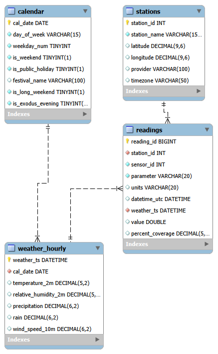
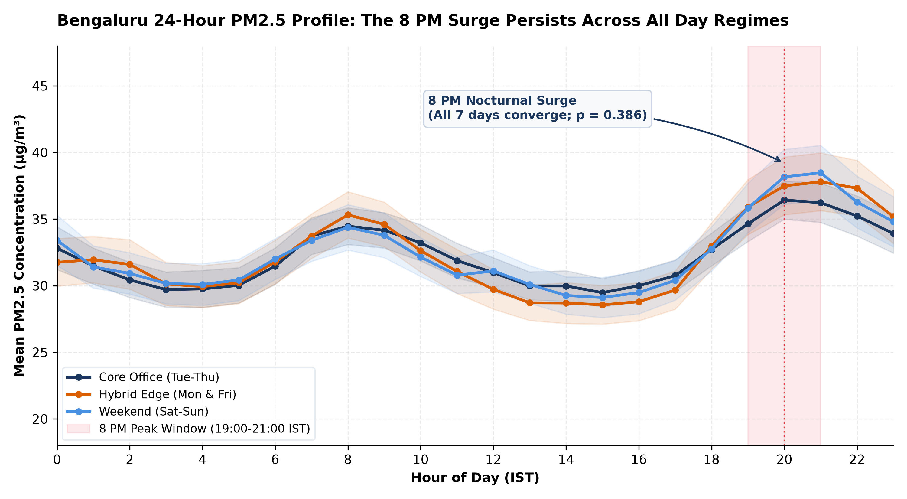
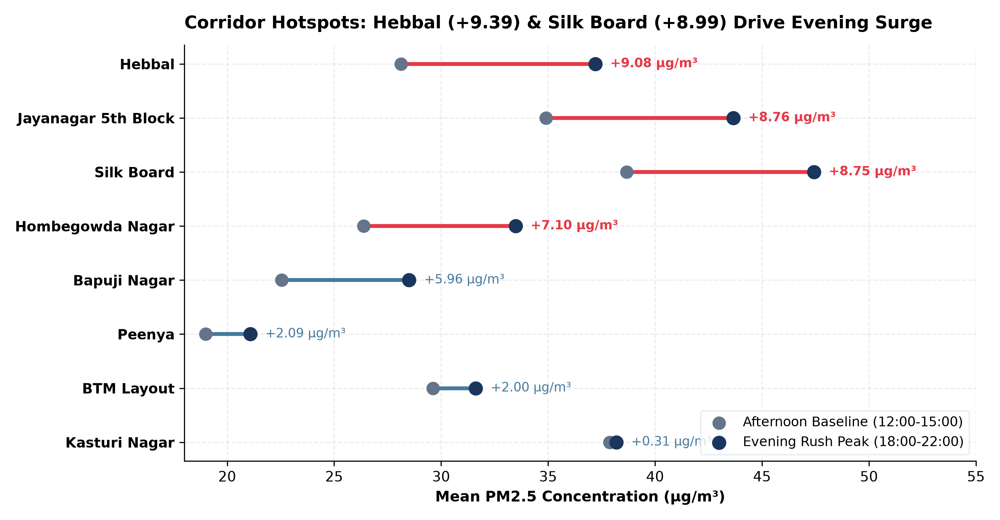
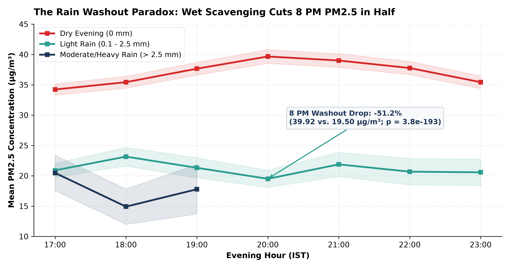
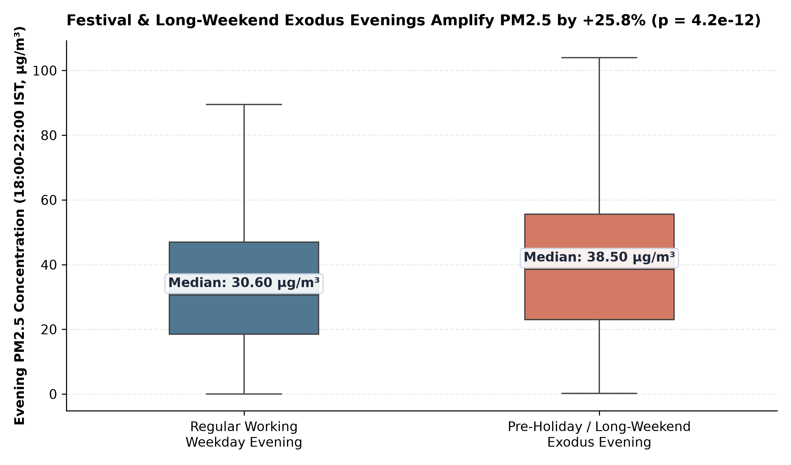

# The 8 PM Problem: Empirical Analysis of Bengaluru's Evening Air Quality & Commuter Exposure Surge

An end-to-end data engineering, relational modeling, statistical inference, and policy storytelling case study investigating Bengaluru's evening air-quality spike (19:00–21:00 IST) across **November 2025 – November 2026** ($N = 236,991$ database records).

---

## Executive Summary & Key Findings

1. **Significant 8 PM Surge ($p = 6.40 \times 10^{-66}$):** Citywide median $\text{PM}_{2.5}$ climbs from **26.10 µg/m³** (12:00–15:00 IST) to **32.30 µg/m³** (19:00–21:00 IST), adding **+3.82 µg/m³** ($p = 7.05 \times 10^{-44}$) in multivariable OLS regression ($R^2 = 0.224$) after controlling for station fixed effects, wind speed, humidity, rainfall, and calendar regimes.
2. **Corridor Bottlenecks Drive the Spike:** Commuter hubs at **Hebbal (+9.39 µg/m³)** and **Silk Board (+8.99 µg/m³)** exhibit steep evening surges, whereas industrial **Peenya (-0.67 µg/m³)** shows no evening increase.
3. **The Rain Washout Paradox ($p = 3.78 \times 10^{-193}$):** Although evening rain triggers traffic congestion headlines, wet scavenging cuts 8 PM $\text{PM}_{2.5}$ by **51.2%** (**19.50 µg/m³** during light rain vs. **39.92 µg/m³** on dry evenings). Dry, stagnant evenings represent the primary public health hazard.
4. **7-Day Persistence & Exodus Amplification ($p = 4.18 \times 10^{-12}$):** Evening $\text{PM}_{2.5}$ remains elevated across Core Office Days (Tue–Thu: **32.50 µg/m³**), Hybrid Edge Days (Mon/Fri: **31.60 µg/m³**), and Weekends (**32.50 µg/m³**; $p = 0.386$), and jumps by **+25.8%** (**38.50 vs. 30.60 µg/m³**) on **Pre-Long-Weekend and Festival Exodus Evenings**.

Read the full policy brief in [`docs/executive_decision_brief.md`](docs/executive_decision_brief.md).

---

## Relational Database Architecture (`bengaluru_8pm_db`)

All multi-source datasets are normalized into 4 third-normal-form tables in **MySQL 8.0**:
* `stations` (10 rows): CPCB and KSPCB monitoring stations across Bengaluru (`station_id` PK).
* `calendar` (380 rows): Day-of-week, Karnataka public holidays, festivals, long weekends, and pre-holiday exodus evening flags (`cal_date` PK).
* `weather_hourly` (9,120 rows): Open-Meteo hourly temperature, relative humidity, precipitation, rain, and 10m wind speed (`weather_ts` PK, `cal_date` FK).
* `readings` (227,481 rows): OpenAQ hourly sensor observations for `pm25`, `pm10`, `no2`, and `co` (`reading_id` PK, `station_id` FK, `weather_ts` FK).



---

## Visual Highlights

| Diurnal Work-Week Curve | Corridor Surge Hotspots |
| :---: | :---: |
|  |  |

| Rain Washout Paradox | Festival & Long-Weekend Exodus Impact |
| :---: | :---: |
|  |  |

---

## Repository Structure

```text
├── docs/
│   └── executive_decision_brief.md      # Actionable policy brief for Bengaluru Urban Services Cell
├── outputs/
│   ├── er_diagram.png                   # Reverse-engineered MySQL Workbench ER diagram
│   ├── fig1_diurnal_hybrid_curve.png    # 24-hour PM2.5 curve by work-week regime
│   ├── fig2_corridor_surge_dumbbell.png # Afternoon-to-evening surge across 10 stations
│   ├── fig3_rain_washout_paradox.png    # Dry vs. rainy evening PM2.5 scavenging curves
│   └── fig4_exodus_evening_impact.png   # Pre-long-weekend/festival exodus evening surge
├── scripts/
│   ├── load_mysql.py                    # Chunked batch loader into MySQL 8.0 (236,991 rows)
│   ├── phase3_stats.py                  # Data cleaning, Mann-Whitney/Kruskal-Wallis tests & OLS
│   └── phase3_charts.py                 # 300-DPI Matplotlib/Seaborn visualization pipeline
├── sql/
│   ├── schema.sql                       # Relational DDL with primary/foreign keys & indexes
│   └── analysis_queries.sql             # 5 multi-table analytical JOIN queries
└── .gitignore